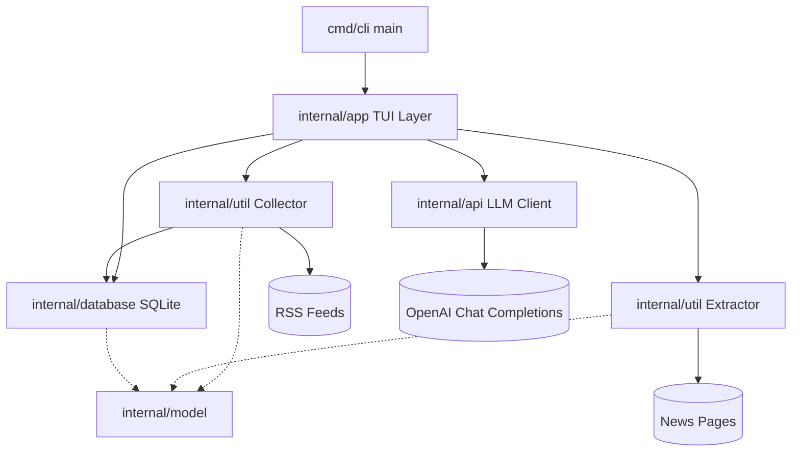

# Architecture

This page shows the layers and module dependencies of go-rss-reader in one overview diagram; per-module structure, data flow, and the state machine are in [doc/architecture.md](https://github.com/pardnchiu/go-rss-reader/blob/main/doc/architecture.md).

## Overview

Other terminal feed readers cover the same space: newsboat (C++, RSS/Atom for text terminals), eilmeldung and feedr (Rust TUIs; feedr also reads full articles in the terminal), nom and gorss (Go terminal readers), and matcha (Go, a daily digest for Markdown readers or terminals). tide is a Go TUI reader with AI summaries, while miniflux takes the opposite form: a self-hosted reader deployed on a server. go-rss-reader is a single Go TUI built on tview that keeps every article, its extracted full text, the feed list, and the last summary in one SQLite file, extracts full text in the background for each new article, and maintains one rolling AI news summary across all feeds with gpt-4o-mini, sending the previous summary back with each request.

## Layers

| Layer | Package | Responsibility |
|-------|---------|----------------|
| Entry point | `cmd/cli` | Calls `app.New()` and `Run()`, prints the error if launch fails |
| Application | `internal/app` | tview layout, hotkeys, command parsing, refresh scheduling, and coordination of the modules below |
| Collection | `internal/util` (`Collector`) | Feed add/remove, RSS fetch and parse, deduplication, time-window filtering |
| Extraction | `internal/util` (`Extractor`) | Fetches the original page and extracts title, author, body, and word count |
| LLM | `internal/api` | Streams OpenAI Chat Completions |
| Storage | `internal/database` | SQLite path resolution, table creation, article/feed/key-value access |
| Data model | `internal/model` | `News`, `NewsContent`, `RSS`/`Channel`/`Item` |

Every package lives under `internal/`, so none of them can be imported from outside the module.

## Cross-Cutting Principles

| Principle | Implementation |
|-----------|----------------|
| UI updates only on the tview main thread | Background goroutines always update the screen through `app.QueueUpdateDraw()` |
| Cache first | While the list is empty, `database.Get(72)` fills it before the network fetch |
| Failures do not stop the run | A failing feed or a failing extraction is logged and skipped without affecting other items |
| Single data file | Articles, feeds, the API key, and the digest all live in one SQLite file |

## Further Reading

- [Refresh Cycle](/refresh-cycle): the full order of one check, from fetch to digest
- [Storage](/storage): table structure and access methods
