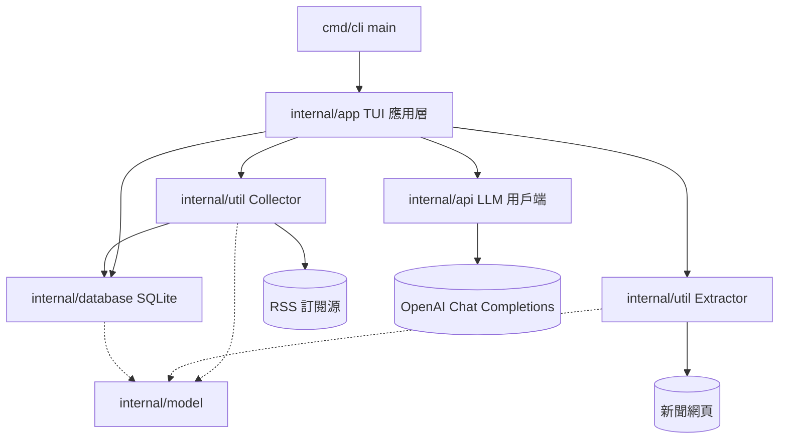

# 架構

本頁以一張概覽圖說明 go-rss-reader 的分層與模組相依；各模組內部結構、資料流與狀態機見 [doc/architecture.zh.md](https://github.com/pardnchiu/go-rss-reader/blob/main/doc/architecture.zh.md)。

## 概覽

同樣在終端機讀 RSS 的工具還有 newsboat（C++，文字終端機的 RSS／Atom 閱讀器）、eilmeldung 與 feedr（Rust TUI；feedr 也能在終端機讀全文）、nom 與 gorss（Go 終端機閱讀器），以及 matcha（Go，給 Markdown 閱讀器或終端機的每日摘要）。tide 是附 AI 摘要的 Go TUI 閱讀器；miniflux 則是型態相反的自架伺服器閱讀器。go-rss-reader 是以 tview 建構的單一 Go TUI，把每篇文章、萃取出的全文、訂閱源清單與上一份概要存在同一個 SQLite 檔，對每篇新文章在背景萃取全文，並以 gpt-4o-mini 維護一份橫跨所有訂閱源的滾動式 AI 新聞摘要，每次請求都帶上前一份概要。

## 分層

| 層 | 套件 | 職責 |
|----|------|------|
| 進入點 | `cmd/cli` | 呼叫 `app.New()` 與 `Run()`，啟動失敗時印出錯誤 |
| 應用層 | `internal/app` | tview 版面、快捷鍵、指令解析、刷新排程，並協調下列模組 |
| 收集 | `internal/util`（`Collector`） | 訂閱源增刪、抓取與解析 RSS、去重、時間窗篩選 |
| 萃取 | `internal/util`（`Extractor`） | 抓取原始網頁並萃取標題、作者、正文、字數 |
| LLM | `internal/api` | 串流呼叫 OpenAI Chat Completions |
| 儲存 | `internal/database` | SQLite 路徑判斷、建表、文章／訂閱源／鍵值存取 |
| 資料模型 | `internal/model` | `News`、`NewsContent`、`RSS`／`Channel`／`Item` |

所有套件都在 `internal/` 之下，不提供可被外部 import 的 API。

## 跨切原則

| 原則 | 實作 |
|------|------|
| UI 更新只走 tview 主執行緒 | 背景 goroutine 一律以 `app.QueueUpdateDraw()` 更新畫面 |
| 快取優先顯示 | 列表為空時先以 `database.Get(72)` 顯示，再抓網路 |
| 失敗不中斷 | 單一訂閱源抓取失敗、單篇萃取失敗只寫 log 並略過，不影響其他項目 |
| 單一資料檔 | 文章、訂閱源、API 金鑰、概要都存在同一個 SQLite 檔 |

## 延伸閱讀

- [刷新流程](/zh/refresh-cycle)：一次檢查從抓取到概要的完整順序
- [儲存](/zh/storage)：資料表結構與存取方法
